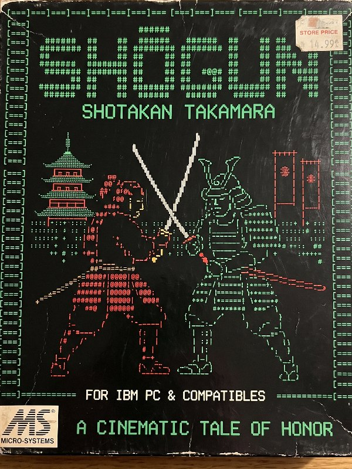
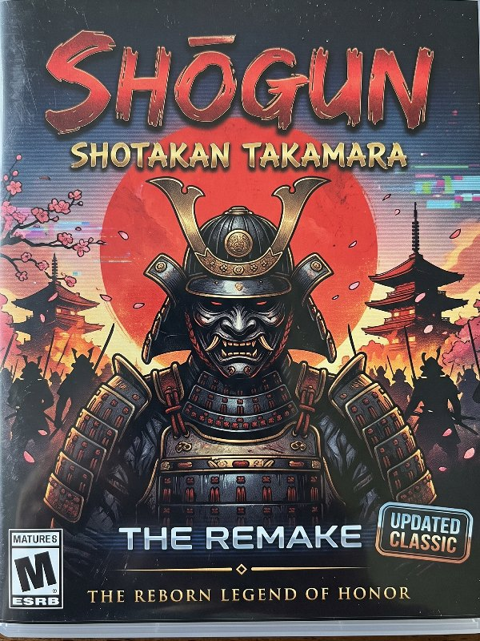
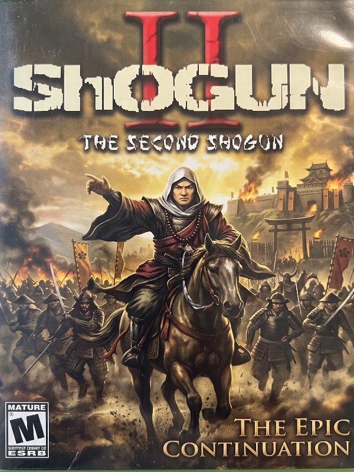

# Shogun Classics

Three Shogun fighting games, 1996 to 2026, in one collection you can play in a browser.

**Play: https://lucidium2000.github.io/Shogun-Classics/**

<p align="center">
  <a href="shogun-1996/"></a>
  <a href="shogun-remastered/"></a>
  <a href="shogun-ii/"></a>
</p>

| Game | Year | What it is |
| --- | --- | --- |
| [Shogun](shogun-1996/) | 1996 | The original QBasic game by Mystical Software, running its real source in a small QBasic interpreter written in JavaScript. A "Restored" switch fixes the 1996 bugs; "Original" runs the files as found. |
| [Shogun Remastered](shogun-remastered/) | 2026 | A modern remake of the 1996 game: real-time fights, block-pixel fighters, the same ladder (Wan'fu, Yamana, Frill), and on-screen FINISH HIM codes. |
| [Shogun II Restored](shogun-ii/) | 2003 / 2026 | The unfinished sequel built on the KOF91 engine, compiled to WebAssembly. Filmed Keero and Corbin sprites, the full Shogun cast, new stages and the original title song. |

Works on desktop (keyboard or gamepad) and on phones (touch controls).

## Repository layout

```
index.html              collection menu
shogun-1996/            Shogun (1996), one self-contained page
shogun-remastered/      Shogun Remastered, one self-contained page
shogun-ii/              Shogun II Restored: page, JS host, engine and data pack
covers/                 box art used on the menu
source/
  launcher/             menu source
  shogun-1996/          original .BAS files, interpreter (engine.js), page template
  shogun-remastered/    remake source (rig, stages, fighters, audio, game loop)
  shogun-ii/            engine patches, Allegro shim and asset tools (see its README)
tools/standalone.py     adds the HTML skeleton to body-only pages
build.sh                rebuilds the pages from source/
```

## Building

The pages are prebuilt, so nothing is needed to play. To rebuild after editing
`source/`, run `./build.sh` (Python 3). Shogun II's engine has its own steps in
[source/shogun-ii/README.md](source/shogun-ii/README.md).

To play locally, serve the folder (for example `python3 -m http.server`) and open
http://localhost:8000. Shogun II needs a web server; the other two also open
straight from disk.

## Credits

Created by Chris ([lucidium2000](https://github.com/lucidium2000)) with
**Corbin Hildreth**, **Jason Rudisill**, **Chance Kornegay** and **Elijah Matthew Cash**,
as Mystical Software, starting in 1996.

## License

Copyright (c) 1996-2026 Chris ([lucidium2000](https://github.com/lucidium2000)) and
Mystical Software. The Shogun games' own code, art and music are released under the
[MIT License](LICENSE). Shogun II includes the KOF91 engine by Moah, which keeps
its own freeware terms; see [NOTICE.md](NOTICE.md).
